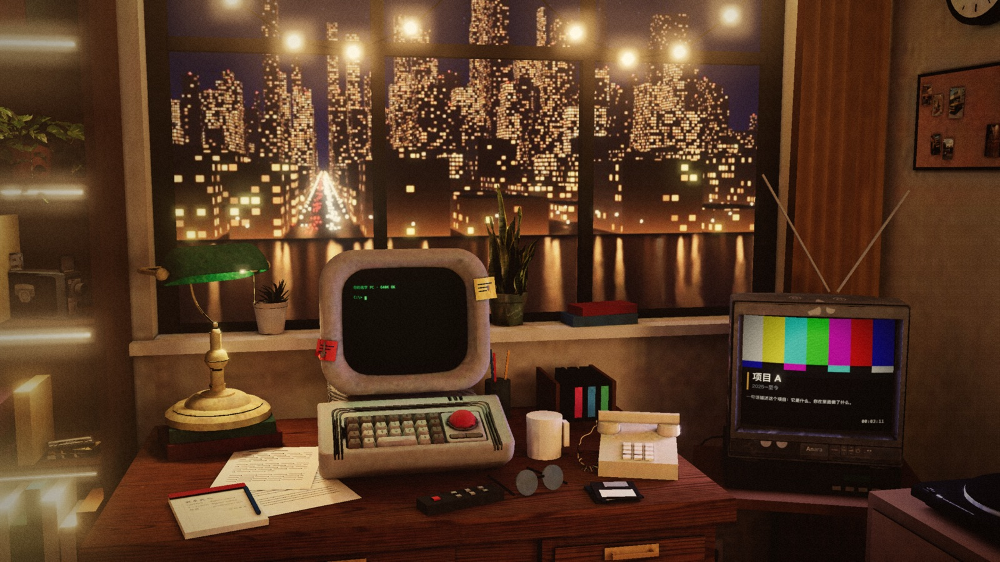
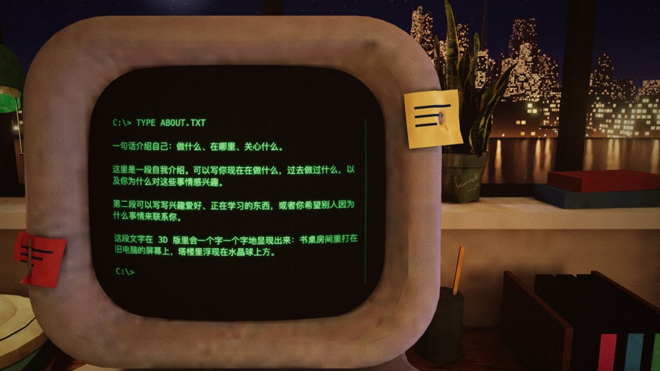
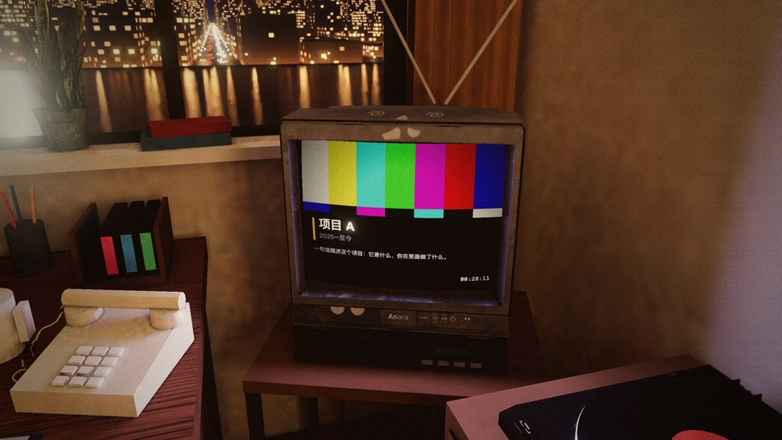
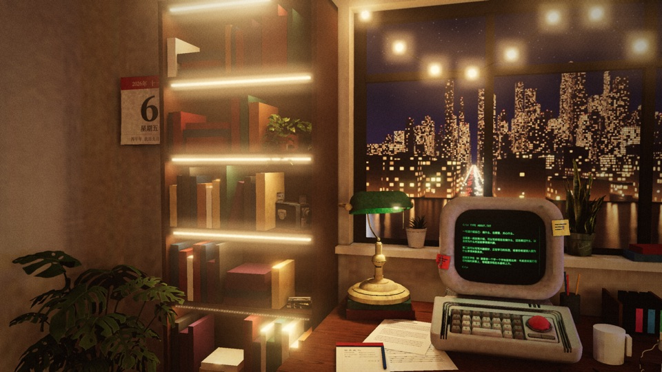
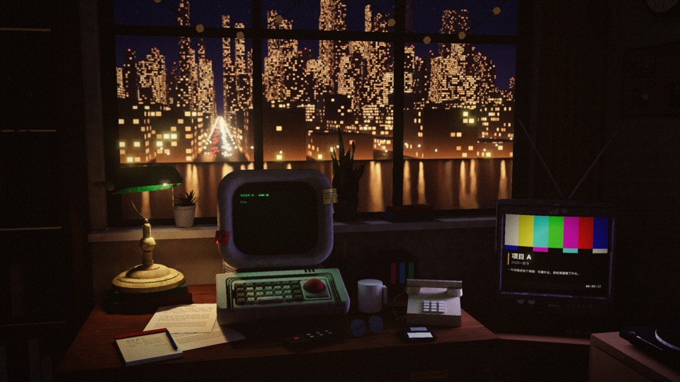
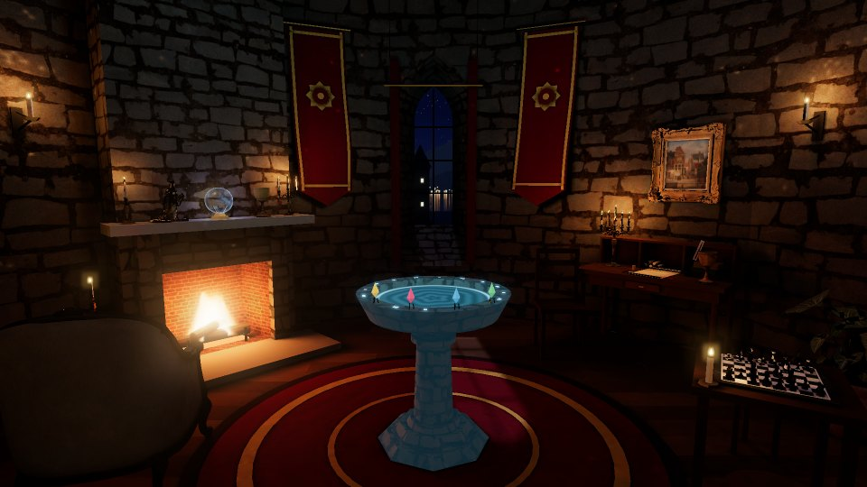
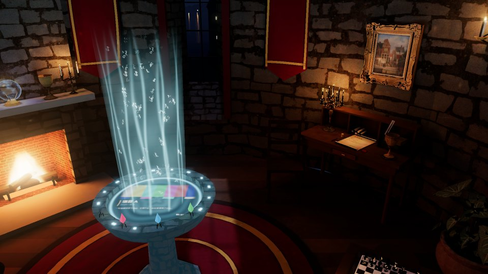
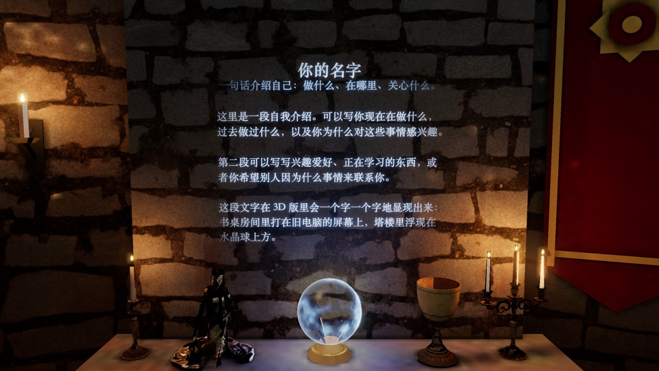
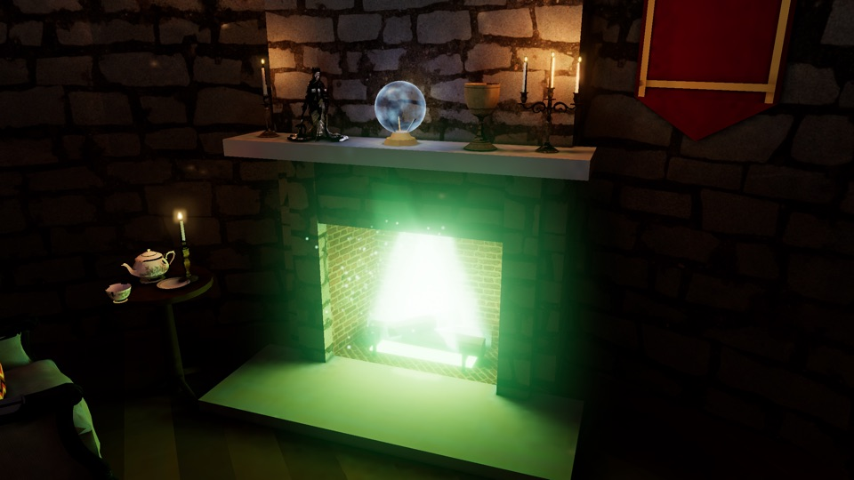

<h1 align="center">SceneCV · 走进你的简历</h1>

<p align="center">
  一份可以走进去的 3D 简历模板。<br>
  旧电脑讲"关于我"，录像带放作品，记事本上写着联系方式：访客转一转、点一点，就认识了你。
</p>

<p align="center">
  <a href="#运行">本地运行</a> ·
  <a href="#改内容">改成你的简历</a> ·
  <a href="#能做什么">全部玩法</a> ·
  <a href="#第三方素材">素材致谢</a>
</p>



- **物件就是菜单**：点电脑、录像带、记事本或书架，镜头飞过去，对应的内容打开。顶部导航栏和地址栏跟着变，每一页都能直接分享。
- **光照是烘焙好的**：房间由 Blender 脚本搭出来，光照烘焙成贴图，浏览器只负责呈现，首次打开下载约 7 MB。开灯关灯、换录像带，屋里的光都会跟着变。
- **两个场景，一份内容**：书桌房间和塔楼书房读的是同一份 `index.html`，换场景不用改内容；跑不动 3D 的设备自动显示纯文字版。
- **零依赖的静态网站**：没有构建步骤，也没有 npm 依赖。改完 `index.html` 就能放到 GitHub Pages、Vercel 或 Netlify。

灵感来自 felixrieseberg.com 的空间式个人网站。

## 看一看

### 书桌房间（默认）

<table>
  <tr>
    <td width="50%"></td>
    <td width="50%"></td>
  </tr>
  <tr>
    <td><b>电脑 · 关于我</b><br>镜头飞到屏幕前，终端一个字一个字打出你的介绍。</td>
    <td><b>录像机 · 作品</b><br>点架子上的一盘带子，它飞进录像机，雪花之后开始播放，屋里被电视的颜色照亮。</td>
  </tr>
  <tr>
    <td></td>
    <td></td>
  </tr>
  <tr>
    <td><b>书架 · 书单</b><br>往左转头是书架，面板里是推荐的书；墙上的撕页日历翻到当天的日期。</td>
    <td><b>开灯关灯</b><br>台灯和屋里的灯都能点，关掉以后只剩屏幕和窗外的城市。画面上还有一层暖胶片滤镜，可以换成录像带、褪色相纸等几种。</td>
  </tr>
</table>

### 塔楼书房（`?scene=tower`）

<table>
  <tr>
    <td width="50%"></td>
    <td width="50%"></td>
  </tr>
  <tr>
    <td><b>城堡塔楼里的书房</b><br>尖拱窗外是夜里的湖和远处的塔。壁炉和蜡烛都能点灭点亮，窗边两面挂旗随风轻轻摆动。</td>
    <td><b>水盆 · 作品</b><br>点一颗水晶，它落进水盆，升起光柱和浮动的符号，水面上映出项目画面。</td>
  </tr>
  <tr>
    <td></td>
    <td></td>
  </tr>
  <tr>
    <td><b>水晶球 · 关于我</b><br>球里的雾转起来，介绍一个字一个字浮现在球上方。</td>
    <td><b>揉纸投火 · 联系方式</b><br>点联系链接，写着它的那张纸被揉成一团扔进壁炉，火变成绿色，然后跳到那个链接。</td>
  </tr>
</table>

## 运行

需要 Node.js 22 或更新版本。无 npm 依赖，不需要安装或构建即可预览：

```bash
node scripts/serve.mjs
```

然后打开 http://localhost:5173 （书桌房间）或 http://localhost:5173/?scene=tower （塔楼书房）。`?room=1` 强制 3D 版，`?plain=1` 强制静态版。全是静态文件，没有构建步骤，可以直接放到 GitHub Pages / Vercel / Netlify。

**当前范围：** 两个场景、前端交互、Blender 制作脚本和本地静态文件服务已经包含在仓库中。尚无账号、数据库、保存简历的 API 或在线编辑器。Three.js 与塔楼的 Draco 解码器从 CDN 加载，因此首次运行需要联网。

验证：`npm test` 检查本地文件服务的访问边界；`npm run audit:public` 检查已跟踪文件的敏感路径、常见凭据特征和发布文件范围。自动扫描不能代替对新增内容和第三方素材的人工检查。

## 公开版本

本仓库使用示例姓名、联系方式和项目链接。个人学习记录、本机工具设置、原始素材下载目录、临时打包文件与私有配置不包含在公开版本中。Blender 源文件保留可编辑性，图片与模型中的本机路径元数据已清理。检查范围见 [发布检查记录](docs/PUBLICATION.md)。

这是可公开浏览的项目，尚未指定整个项目的代码许可证；第三方素材继续遵循各自的许可证，详见下方素材说明。

## 能做什么

| 交互 | 说明 |
|---|---|
| 开场 | 镜头正对着窗下书桌上的电脑，绕着它转。往左拖看到书架，往右拖看到矮柜上的唱机和软木板；滚轮 / 双指拉近拉远 |
| 顶部导航栏 | 左边是名字，右边是 关于 / 作品 / 书架 / 联系。点一项和点对应的物件效果一样：镜头飞过去、面板打开、地址跟着变；鼠标停在某一项上，对应的物件会亮起来。当前项反色显示，再点一次或点名字回到书桌。两个场景和纯文字版共用 |
| 悬停 | 物件变亮、旁边出现提示；录像带会从架子上往上抽出一点 |
| 电脑 | 镜头飞到屏幕前，终端一个字一个字打出"关于我"；滚轮 / 方向键翻页，点一下直接显示全部 |
| 电视 / 录像带架 | 作品。点架子上任意一盘带子：上一盘退出来放回架子，新的一盘飞进录像机，雪花之后开始播放；房间被电视画面的颜色照亮 |
| 面板 | 作品视角下有 ◀◀ ■ ▶▶（键盘 ← → 空格）和项目链接 |
| 记事本 / 电话 | 联系方式手写在纸上（贴在烘焙好的纸面上，跟着台灯明暗），面板里是可点击的链接 |
| 书架 | 在书桌左边、后墙上，镜头飞过去，面板里是书单 |
| 台灯、落地灯、柜上台灯 | 点一下开关灯，光照实时变化 |
| 致谢 | 底部的"致谢"（`#credits`）：房间用到的每件第三方素材的作者、原作链接、许可和改动，镜头不动，只开面板 |
| 路由 | `#about` `#work` `#shelf` `#online` `#credits` 是真实地址，可以直接分享；浏览器后退键、页面上的"← 返回"、Esc、导航栏上的名字都能回到书桌 |
| 加载 | 下载进度条（约 7 MB）；跑不动 WebGL2 的设备直接看静态版 |
| 手机 | 竖屏时面板在下方，镜头低头把物件放在面板上方；自动降分辨率、关辉光保帧率 |

## 塔楼书房（`?scene=tower`）

圆形石塔的一层：一扇窄长的尖拱窗（窗外是夜里的湖、山和远处另一座塔），左边壁炉，中间一只石头水盆，右边书桌，四周是书架、扶手椅、茶几、柜子、棋桌和烛台。保留夜间氛围，同时加强月光、周围烛光和盆的常亮蓝青色底光，让石墙、家具和盆体可辨。

| 物件 | 说明 |
|---|---|
| 水盆 · 作品 | 开场所有水晶都在盆沿，盆体、水面和符文持续发光。点一颗，水晶落水激起亮纹，光柱升起，随后浮现程序绘制的不可读碎片符号，约 8.5 秒后消散。镜头先框住完整光柱，在光柱消散时平滑移回对准盆内画面的近景；再次换水晶时平滑拉远。水面显示项目画面，项目色轻微染入盆光；上一颗会浮回原位。面板里 ◀ ▶（键盘 ← →）换项目，可连续切换 |
| 水晶球 · 关于我 | 在壁炉架上。镜头飞过去，球里的雾转起来，介绍一个字一个字浮现在球上方；滚轮 / ↑ ↓ 翻页，点一下显示全部 |
| 羊皮纸 · 联系方式 | 在书桌上，旁边是羽毛笔、墨水瓶和火漆印。联系方式写在纸上，面板里是可点击的链接 |
| 揉纸投火 | 点面板里的联系链接，写着联系方式的那张纸会揉成一团，扔进壁炉；火变成绿色窜出炉口，喷出火星，整间屋被绿光照亮，约 3 秒后在本页跳到那个链接。中途点一下直接跳，Esc 取消；按住 ⌘ / Ctrl 点击或系统开了"减少动态效果"时照常在新标签页打开。从目标网站后退回来，纸还在桌上 |
| 书架 · 书单 | 靠墙的大书架，拖动转头能看到 |
| 壁炉、蜡烛 | 点一下熄火 / 生火、熄灭 / 点亮全部蜡烛，光照实时变化。都灭了只剩窗外的月光和水盆的光 |
| 棋桌 | 摆着开局几步后的棋局，一个兵和一匹马会自己来回走 |
| 窗边挂旗 | 两面深红挂旗各自随机选择左右方向、幅度和持续时间，平滑摆动；上沿固定，金边和纹样跟随布面弯曲；系统开启"减少动态效果"时保持静止 |
| 素材致谢 | 首页底部的链接（`#credits`，和书桌房间同一个地址），列出用到的每个第三方素材、作者和许可证；镜头不动，只开面板 |

水盆里现在放的是电视那套画面（`js/tapes/`），之后可以换成每个项目真正的截图或录屏。

关于参考：塔楼的陈设参考的是常见的哥特式城堡塔楼（石墙、尖拱窗、挂旗、壁炉、烛台），水盆和水晶球是原创的设计（放进水里的是发光的水晶）。网站里没有用任何影视、游戏作品里的名字、校徽或角色。

## 改内容

内容全在 `index.html`，3D 版从这里读，静态版就是这份 HTML 本身。

- 导航栏：每个带 `data-nav` 的 `<section>` 在顶部导航栏里出现一项，`data-nav` 是显示的名字。新加的一节如果场景里还没有对应的物件，导航栏上的这一项会打开纯文字版的那一节。

- 名字、介绍：`<h1>`、`.tagline`、`#about`。
- 作品：`#work` 里每个 `<li>` 是一盘录像带。`data-tape` 选电视画面（`bars` / `synth` / `bounce` / `rain`），`data-color` 是带子侧标颜色（架子上的带子会跟着变）。桌上的架子放得下 4 盘。塔楼里每个 `<li>` 是盆沿上的一颗水晶，也是最多 4 颗，水晶颜色同样取 `data-color`。
- 书单：`#shelf` 里每个 `<li>` 一本书，`<a>` 书名和链接，`.by` 作者，`<p>` 一句话推荐。
- 联系方式：`#online`，会同时写在记事本（塔楼里是羊皮纸）上和面板里。
- 加一种电视画面：在 `js/tapes/` 写一个模块，接口是 `mount({ ctx, width, height, tape }) → { frame(t, dt) }`，然后在 `js/tapes/index.js` 注册。

## 代码结构

| 文件 | 作用 |
|---|---|
| `js/main.js` | 设备检测，决定加载 3D 版还是静态版；生成顶部导航栏 |
| `js/nav.js` | 顶部导航栏：从内容层的 `section[data-nav]` 生成，3D 版里接到场景的 `go()`（和点物件同一个入口），纯文字版里是页内锚点 |
| `js/content.js` | 从 HTML 读出内容（介绍、作品、书单、联系方式） |
| `js/baked.js` | 加载烘焙结果（带进度）、光照着色器、热点高亮、记事本贴花、把录像带拆成能单独移动的物体 |
| `js/room.js` | 交互：镜头（绕着电脑转 + 飞到物件前）、拾取、路由、面板、录像带动画、开关灯 |
| `js/grade.js` | 书桌房间的整体滤镜（调色、暗角、颗粒、录像带效果），几种预设可以切换 |
| `js/calendar.js` | 书桌房间墙上撕页日历的纸页（按当天日期画） |
| `js/pc.js` / `js/tv.js` / `js/tapes/` | 电脑终端、电视、每盘带子的画面（都画在 2D canvas 上当贴图） |
| `js/tower.js` | 塔楼书房的交互：水晶落进水盆、水晶球、羊皮纸、火和蜡烛、棋子、素材致谢面板（镜头和路由跟 `room.js` 一样） |
| `js/magic.js` | 塔楼里的着色器：水面（涟漪 + 项目画面）、水晶球的雾、火焰、水晶；水晶球上方浮现的文字 |
| `js/tower-banners.js` / `js/banner-wind.js` | 挂旗布面细分与随机微风动画，保留原有烘焙光照和纹样 |
| `js/basin.js` | 冥想盆入水后的光柱、延迟浮现的伪字形图集与消散动画（不使用文字字体） |
| `js/paper-fire.js` | 塔楼联系方式的揉纸投火：细分的纸网格（沿用烘焙光照，换上去看不出来）、揉皱、抛物线、绿色火星、跳转前的绿光；火怎么变绿由 `tower.js` 按它给的系数调光照层 |
| `js/paint.js` | 记事本纸面、羊皮纸纸面 |
| `blender/` | 生成窗外夜景、搭房间、烘焙光照的 Python 脚本（`*_tower*.py` 是塔楼） |
| `lab/bake.html` | 烘焙结果的调试页：单独看每层光、调强度（还没跟上 Draco 压缩和新的镜头参数，暂时打不开，见 `ROADMAP.md` 第 3 节） |
| `lab/assets.html` | 挑素材用的候选页：Poly Haven 和 Sketchfab 上的一百多个候选，勾选后复制清单 |
| `assets/vendor/` | 第三方 3D 素材的清单（`credits.json`）和许可证说明 |
| `scripts/fetch_assets.mjs` | 把第三方素材的原始文件下载到 `vendor-src/`（不进仓库） |
| `scripts/credits_html.mjs` | 从 `credits.json` 生成 `index.html` 里书桌房间的致谢列表 |

## 第三方素材

书桌房间用了 14 件第三方素材：12 件来自 Sketchfab（CC BY 4.0，要署名并注明改动），2 件来自 Poly Haven（CC0）。塔楼里的家具、灯和小物件来自 Poly Haven（CC0）。网站上的署名：书桌房间在 `#credits`，纯文字版里也有；列表由 `node scripts/credits_html.mjs` 从 `credits.json` 生成进 `index.html`，换了素材要重新跑一次（`npm test` 会检查是不是最新的）。塔楼在底部的"素材致谢"里。这些素材保留各自的许可证，不受仓库代码许可证约束，详见 [`assets/vendor/README.md`](assets/vendor/README.md)。原始文件不进仓库，需要时重新下载：

```bash
node scripts/fetch_assets.mjs
```

房间里的坐标一个都没写在 JS 里：每个物件的热点盒子、点进去时镜头看哪里、看多大，都由烘焙脚本算好写进 `assets/baked/manifest.json`（`hotspots`、`views`、`tapes`；塔楼是 `assets/tower/manifest.json`，多了 `gems`、`chess`、`fire`）。在 Blender 里挪动物件，重新导出就行。

## 烘焙光照（Blender → 浏览器）

两步，都是不开界面跑完的 Python 脚本：

```bash
/Applications/Blender.app/Contents/MacOS/Blender -b --factory-startup --python blender/render_view.py -- --width 2560 --samples 64
```

```bash
/Applications/Blender.app/Contents/MacOS/Blender -b --factory-startup --python blender/bake_room.py -- --size 2048 --samples 256
```

只改了热点、镜头视角之类、不影响光照的东西时，加 `--skip-bake 1` 跳过烘焙，几秒钟重新导出模型和 manifest：

```bash
/Applications/Blender.app/Contents/MacOS/Blender -b --factory-startup --python blender/bake_room.py -- --skip-bake 1
```

- **窗外**（`blender/render_view.py`）：程序生成一座城市：楼前一条河、左边一座桥、对岸起是街区，远处有市中心的高楼群，加上月亮和星空。Cycles 把它渲染成两张卡片：250 米以内一张（透明底 WebP），250 米以外加天空一张（JPG）。浏览器里两张卡片分别放在窗外 10 米和 40 米处，鼠标移动时近景和远景错开，看起来有纵深。
- **房间**（`blender/bake_room.py`）：3.3 × 3.0 米的小书房，东西都挨着后墙。窗下一张 1.24 米宽的胡桃木书桌（5.5 厘米厚的桌面、倒角边，右边三个抽屉、中间一个浅抽屉，都是铜拉手；木纹是烘焙时程序生成的 1024² 贴图，三块拼板，年轮是山形纹），正中是米色的老式台式电脑（方屏、窄边框，显示器压在卧式主机上，软驱里插着一张软盘，侧面贴着便利贴），前面是自己搭的键盘，右边是鼠标；旁边是垫在两本旧书上的台灯、录像带架、咖啡杯、眼镜、遥控器、记事本和笔筒，还有随手放的杂物：两张打印纸、一摞软盘、一部按键电话（也算“联系方式”）；书桌右边一辆小推车，上面是电视和录像机，斜着朝向镜头，站在窗户右半边前面。书桌左边是书架（自己搭的，书是随机的方块，右头摆着 8 毫米摄影机、几盘磁带和一小盆垂下来的绿萝）和龟背竹，地上一摞没放回去的书；窗右边一幅收起来的窗帘；右墙是矮柜、唱机、挂画、软木板、挂钟和几张拍立得。开场镜头站在电脑正前方、绕着电脑转，电脑在画面正中，右边露出半台电视；视角 34°，抬头到不了天花板，左右转到头能看到侧墙靠里的一段。
- **光分四层**烘焙：环境（月光 + 窗外城市的光 + 电脑屏幕）、屋里的灯（落地灯、窗上串灯、书架灯带、柜上台灯）、书桌台灯、电视。开关灯、电视换色都只是着色器里改系数，不用重新算光照。
- **整体滤镜**（`js/grade.js`）：接在色调映射后面，做调色、暗角、颗粒、柔焦，录像带那种还有扫描线和红蓝错位。默认是 `film` 暖胶片，`?look=名字` 换一种（`none` 原样 / `cine` 夜色电影 / `vhs` 录像带 / `polaroid` 褪色相纸 / `lofi` 深夜 lo-fi），`?looks` 在左下角显示一排按钮现场切换。参数都在 `LOOKS` 里，每种也可以顺便改辉光强度。
- **热点**：搭模型时用 `with hot('about'):` 把属于电脑的面标上记号，导出时按记号算出贴身的盒子（可以绕竖轴转，跟着斜放的记事本）。浏览器里射线打到的第一个面落在哪个盒子里，就是点到了什么；高亮也是着色器按这个盒子算的，不需要额外的模型。
- **公共尺寸**都在 `blender/shared.py`（窗户大小、桌面高度、月亮方向、窗外卡片参数）。

实测（Apple M5，10 核 GPU）：窗外夜景 2560×1280、64 采样约 2.5 分钟；房间 2048² 贴图、256 采样、四层烘焙约 3 分钟。浏览器下载约 6.7 MB：`room.glb` 3.4 MB（第三方模型带着各自的颜色贴图，电脑的是 2048²），四张光照贴图 2.9 MB，两张窗外卡片 0.34 MB（`view_full.jpg` 只在烘焙时用）。

### 塔楼

```bash
/Applications/Blender.app/Contents/MacOS/Blender -b --factory-startup --python blender/render_tower_view.py -- --width 1536 --samples 96
```

```bash
/Applications/Blender.app/Contents/MacOS/Blender -b --factory-startup --python blender/bake_tower.py -- --size 2048 --samples 256
```

- 同样支持 `--skip-bake 1`。调构图时加 `--preview home`（也可以 `top` / `about` / `work` / `online` / `shelf`），不烘焙，直接从那个镜头渲一张图到 `assets/tower/preview_*.png`。
- 第三方素材要先用 `node scripts/fetch_assets.mjs` 下载到 `vendor-src/`。脚本会给它们减面、缩小贴图、压暗颜色，具体改了什么写在 `credits.json` 的 `changes` 里。
- 光分四层：环境（月光 + 窗外）、蜡烛（壁灯、吊灯、各处烛台）、壁炉、水盆（项目颜色）。
- 模型带两套 UV（颜色贴图、光照贴图），用 Draco 压缩；网页里的 Draco 解码器从 CDN 加载。
- 实测（Apple M5）烘焙一共不到 1 分钟。浏览器下载约 4.7 MB：`tower.glb` 2.6 MB，四张光照贴图 1.9 MB，窗外两张卡片 0.11 MB。

## 调试

- 主页面：`window.__room`（两个场景都有）。导航栏点击走的也是 `__room.go(id)`。`__room.go('work')` 切视角，`__room.tick(dt)` 手动推进一帧（后台标签页里动画会被浏览器降速），`__room.hoverAt(x, y)` / `clickAt(x, y)` 模拟鼠标。塔楼里还有 `__room.dropGem(i)` 换项目、`__room.light` 看火和蜡烛的状态、`__room.burnLink(i)` 演揉纸投火（会真的跳转；`__room.paperFire.cancel()` 中途恢复）。
- 实验页：`window.__lab.tick(dt)`、`window.__lab.setLook({ yaw, pitch, fov })`。

## 下一步

1. 书桌房间窗外下雨：玻璃上的雨痕、远处的雨幕和被雨打湿的城市灯光。
2. 音效和音乐（Web Audio）：雨声、开关灯、插带子、终端打字。
3. 塔楼书房：水盆里换成每个项目真正的画面；决定默认用哪个场景（或者在页面上加一个切换）。
4. 模型压缩（Meshopt）、贴图转 AVIF / KTX2，把 7 MB 降下来。
5. 部署到 GitHub Pages，在这份 README 的开头放上在线演示链接。
