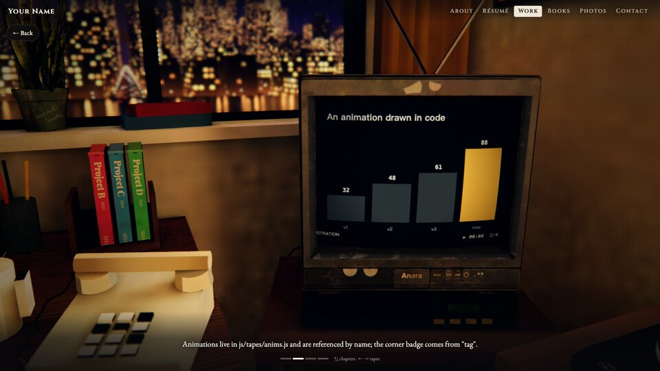
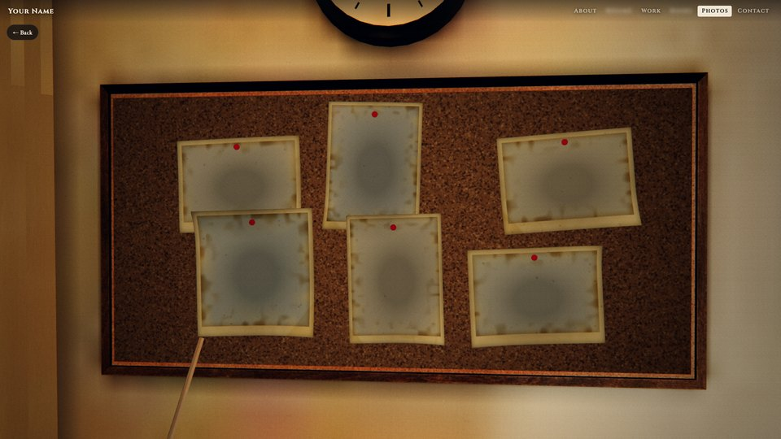
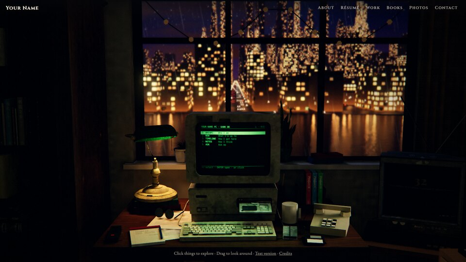

<h1 align="center">SceneCV · 走进你的简历</h1>

<p align="center">
  一份可以走进去的 3D 简历模板。<br>
  旧电脑讲"关于我"，桌上的打印纸是简历，电视放作品，书架上是读过的书，记事本上写着联系方式：访客转一转、点一点，就认识了你。
</p>

<p align="center">
  <a href="https://annoyingc.github.io/scene-cv/">在线演示</a> ·
  <a href="#运行">本地运行</a> ·
  <a href="#改内容">改成你的简历</a> ·
  <a href="#能做什么">全部玩法</a> ·
  <a href="#第三方素材">素材致谢</a>
</p>


- **物件就是菜单**：点电脑、打印纸、录像带、书架、软木板或记事本，镜头飞过去，对应的内容打开。书架上是真书：点一本，它被抽出来、飞到眼前翻开。顶部导航栏和地址栏跟着变，每一页都能直接分享。
- **窗外是活的**：一直下着细雨，云缝里的星空和银河慢慢转，楼里的灯时开时关，车灯沿着街道慢慢开，河面上灯光的倒影被雨点打出一圈圈涟漪。
- **光照是烘焙好的**：房间由 Blender 脚本搭出来，光照烘焙成贴图，浏览器只负责呈现，首次打开下载约 8.5 MB。开灯关灯、换录像带，屋里的光都会跟着变。
- **一份内容，两种呈现**：3D 房间和纯文字版读的是同一份 `index.html`；跑不动 3D 的设备自动显示纯文字版。
- **零依赖的静态网站**：没有构建步骤，也没有 npm 依赖。改完 `index.html` 就能放到 GitHub Pages、Vercel 或 Netlify。

灵感来自 felixrieseberg.com 的空间式个人网站。仓库里的名字、简历、作品、书单、照片和联系方式都是样例，换成你自己的就能用。

## 看一看

<table>
  <tr>
    <td width="50%"></td>
    <td width="50%"></td>
  </tr>
  <tr>
    <td><b>电脑 · 关于我</b><br>镜头飞到屏幕前，终端里是一份菜单：自我介绍、最近在做什么、一路怎么走过来、怎么想问题、问我。选一项，文字一个字一个字打出来。</td>
    <td><b>打印纸 · 简历</b><br>点桌上的两张纸，纸浮起来在眼前叠成一摞，左右翻着看；中英文在同一摞里，可以直接翻到另一种语言。</td>
  </tr>
  <tr>
    <td></td>
    <td></td>
  </tr>
  <tr>
    <td><b>录像机 · 作品</b><br>每盘带子是一档按章节放的小节目，电视下面有字幕。点架子上的一盘，它飞进录像机，雪花之后开始播放，屋里被电视的颜色照亮；放完一遍自动换下一盘。</td>
    <td><b>书架 · 书单</b><br>往左转头是书架，上面是读过的真书：点一本，它被抽出来、飞到眼前翻开，左页印着这本书的代表句，右页是划线。</td>
  </tr>
  <tr>
    <td></td>
    <td></td>
  </tr>
  <tr>
    <td><b>软木板 · 照片</b><br>挂钟下面钉着做旧的照片，角卷起来、互相压着，凑近了可以拖着换位置。</td>
    <td><b>开灯关灯</b><br>台灯和屋里的灯都能点，关掉以后只剩屏幕和窗外的城市。画面是电影感的调色：暖色的灯光往外渗一圈橙红色的晕，串灯拉出细细的横向光丝，对焦跟着镜头看的物件走。</td>
  </tr>
</table>

### 界面语言和字体

界面是英文：顶部导航、物件上的提示、面板、唱片卡片、录像带纸盒、照片墙、简历查看器的按钮、加载和底部提示、素材致谢都是英文；书架上的书是中文内容。电脑菜单和简历可以放多种语言，访客在屏幕上 / 纸堆上面切换。

字体放在 `assets/fonts/`（只取拉丁字符，SIL OFL，许可证文本在同一个文件夹）：Cinzel 用在导航和标题，EB Garamond 用在提示、面板和按钮，Playfair Display 是录像带纸盒封面上的大字。中文字落到宋体 / 系统字体上。网站自带字体文件，不向 Google 请求。

## 运行

需要 Node.js 22 或更新版本。无 npm 依赖，不需要安装或构建即可预览：

```bash
node scripts/serve.mjs
```

然后打开 http://localhost:5173 。`?room=1` 强制 3D 版，`?plain=1` 强制静态版。全是静态文件，没有构建步骤，可以直接放到 GitHub Pages / Vercel / Netlify。

**当前范围：** 书桌房间、前端交互、Blender 制作脚本和本地静态文件服务都在仓库里。没有账号、数据库、保存简历的 API 或在线编辑器。Three.js 和 Draco 解码器从 CDN 加载，所以首次运行需要联网。

验证：`npm test` 检查本地文件服务的访问边界和素材致谢；`npm run audit:public` 检查已跟踪文件里的本机路径、常见凭据特征、联系方式和发布文件范围（还可以放一份不进 Git 的 `.private-terms` 词表，列出不该出现在公开文件里的词，见 `scripts/audit_public.py`）。自动扫描不能代替对新增内容和第三方素材的人工检查。

## 能做什么

| 交互 | 说明 |
|---|---|
| 开场 | 镜头正对着窗下书桌上的电脑，绕着它转。往左拖看到书柜（往左转时转的中心顺带往左挪 15 厘米、镜头拉远一点，书柜整个转进画面；转回正前方就复原），往右拖看到矮柜上的唱机和软木板（往右转时中心往右前方挪、镜头拉远一点、稍微低头，唱机整个转进画面；同样转回来就复原）；滚轮 / 双指拉近拉远。电视一打开网站就在放作品，几盘轮流放 |
| 顶部导航栏 | 左边是名字，右边是 About / Résumé / Work / Books / Photos / Contact。点一项和点对应的物件效果一样：镜头飞过去、面板打开、地址跟着变；鼠标停在某一项上，对应的物件会亮起来。当前项反色显示，再点一次或点名字回到书桌。一开始只看得清 About / Work / Contact，简历、书架、照片三项是模糊的占位、点不了（鼠标停上去提示 Not yet discovered），在房间里找到对应的东西才打开（见下面的"成就"）；纯文字版不上锁 |
| 成就 | 像 Steam 那样，第一次找到某样东西时右下角滑出一张成就卡片（右下角有面板时让开它）：拿起桌上的打印纸（Paper Trail）、走到书架前（Bookworm）、凑近软木板（Pinned Memories），同时导航栏里对应的那一项从模糊里浮出来、可以点了。解锁过的记在这个浏览器里（localStorage），下次来不用重新找 |
| 悬停 | 物件变亮、旁边出现提示；录像带整盒从架子上往上抽出一点 |
| 电脑 | 镜头飞到屏幕前，终端里是一份菜单（`#about` 里的 `.pc-menu`）：每一项是一页文字或一个可以点开的列表（时间线、笔记、问答），文字一个字一个字打出来；时间线里的一条可以"在电视上播放"对应的那盘带子。有几种语言就有几份菜单，屏幕上切换 |
| 打印纸 · 简历 | 点桌上的两张纸，纸浮起来，在眼前叠成一摞 A4 纸，左右翻着看（`#resume`）；同一摞里可以放几种语言，上面的按钮直接翻到那种语言，写了 `data-pdf` 就有下载按钮。字放不下会自动整体缩小一点 |
| 电视 / 录像带架 | 作品。架子上的录像带（Sketchfab 素材）套着纸盒竖着插，纸盒的包装是网页按 `#work` 里的作品画的（书脊竖排名字、封面老式租赁录像带的样子、封底简介和条形码；名字写 `<a>` 的文字，颜色是 `data-color`）。点任意一盘：上一盒飞回架子上自己的位置，新的一盒整盒提起来、飞进录像机，雪花之后开始播放；房间被电视画面的颜色照亮。每盘带子可以是一档按章节放的小节目（片头、代码画的动画、数字卡、图、前后对比、视频、左右对比、片尾），电视下面是字幕和章节条，↑↓ 或点电视换章节；放完一遍自动换下一盘 |
| 面板 | 作品视角下有 ◀◀ ■ ▶▶（键盘 ← → 空格）和项目链接 |
| 记事本 / 电话 | 联系方式手写在纸上（贴在烘焙好的纸面上，跟着台灯明暗），面板里是可点击的链接 |
| 书架 | 在书桌左边、后墙上，镜头飞过去，不弹书单面板：书架本身就是目录，自己点想看的那本（悬停有书名提示）。书架上的真书悬停会抽出一点；点了抽出来、飞到眼前翻开（地址变成 `#shelf/书名`），也不弹面板。划线多的书可以翻页：点右页往后翻、点左页往回翻，点书以外的地方放回去；← → 翻页、翻到头换一本，Esc 合上放回去 |
| 软木板 · 照片 | 挂钟下面，钉着做旧的照片。点它镜头凑到板前，照片就在板上看（`#photos`），可以拖着换位置 |
| 唱机 | 配了曲目以后（见下面"改内容"），点唱机打开唱片卡片：选唱片、播放 / 暂停、调音量、切换黑胶音色 / 原声；唱片以约 33⅓ RPM 起转、停播后减速停下。没配曲目时唱机上是一张没印字的唱片 |
| 台灯、落地灯、柜上台灯 | 点一下开关灯，光照实时变化 |
| 致谢 | 底部的"Credits"（`#credits`）：房间用到的每件第三方素材的作者、原作链接、许可和改动，镜头不动，只开面板 |
| 路由 | `#about` `#resume` `#work` `#shelf` `#photos` `#online` `#credits` 是真实地址，可以直接分享；浏览器后退键、页面上的"← 返回"、Esc、导航栏上的名字都能回到书桌 |
| 加载 | 下载进度条（约 8.5 MB）；跑不动 WebGL2 的设备直接看静态版 |
| 手机 | 竖屏时面板在下方，镜头低头把物件放在面板上方；自动降分辨率、关辉光和景深保帧率 |

## 改内容

内容全在 `index.html`，3D 版从这里读，静态版就是这份 HTML 本身。每一节的写法都写在 `index.html` 的注释里。

- 导航栏：每个带 `data-nav` 的 `<section>` 在顶部导航栏里出现一项，`data-nav` 是显示的名字。新加的一节如果场景里还没有对应的物件，导航栏上的这一项会打开纯文字版的那一节。
- 名字、介绍：`<h1>`、`.tagline`、`#about`。电脑上的菜单是 `#about` 里的 `.pc-menu`（一种语言一份）。
- 简历：`#resume` 里每个 `article.cv-page` 是一张 A4 纸。不想把电话、邮箱写进公开的 `index.html`，可以写在 `assets/resume/resume.html`（写法一样，这个文件夹不进 Git），网页启动时有它就换成它。
- 作品：`#work` 里每个 `<li>` 是一盘录像带，桌上的架子放得下 4 盘。`data-tape` 选电视画面：`bars` / `synth` / `bounce` / `rain` 是几种代码画的画面，`show` 是一档按章节放的小节目，`data-show` 指向它的节目单（`assets/tapes/<名字>/show.json`，章节的写法见 `js/tapes/show.js` 开头，样例在 `assets/tapes/sample/`）。节目里代码画的动画写在 `js/tapes/anims.js`。`data-color` 是带子纸盒和电视灯光的颜色。
- 书单：`#shelf` 里每个 `<li>` 一本书，`<a>` 书名和链接，`.by` 作者，`<blockquote class="key">` 左页单独印的代表句，其余 `<blockquote>` 是右页的划线；`data-size`（宽 × 高 × 厚，毫米）、`data-kind`（精装 / 平装）、`data-color` / `data-ink`、`data-style`（自动画封面的样式）、`data-read` / `data-progress`（读完的时间 / 读到百分之几）的说明写在注释里。改了书的数量或尺寸要重新烘焙房间（书是按尺寸建的模）；书按书单的先后分层，先摆满视线高度那一层，再往下一层、最上一层，每层剩下的空位用旧书补上。真实封面放 `assets/books/covers/`，连同一份 `covers.json`（书名 → 图片文件名），这个文件夹不进 Git；`js/main.js` 加载时按书名给书补上封面，没有就用自动画的封面。
- 照片：`#photos` 里每个 `<li>` 一张 `` + 一行说明。照片先做旧：原图放 `photos-src/`，跑 `/Applications/Blender.app/Contents/MacOS/Blender -b --factory-startup --python blender/age_photos.py -- --src photos-src --out assets/photos`，得到 `名字.webp`、`名字.board.webp`（钉在板上，长边 1024）和照片列表 `photos.json`；有这份列表，软木板就钉这些照片，没有才用 `#photos` 里的照片。做旧是泛黄、褪色、斑驳的污渍和霉点、边角磨旧、折痕；卷边是在网页里把照片的角真的翘起来。照片位置记在浏览器里，要摆回原样在控制台里运行 `__room.cmd('photos-reset')`。做旧会重新编码，原图的 EXIF（拍摄时间、GPS 位置）不会带过去。`photos-src/` 和 `assets/photos/` 都不进 Git；仓库里的样例是几张空白的旧照片（`assets/photos-sample/`，`--demo 1` 生成）。
- 联系方式：`#online`，会同时写在记事本上和面板里。也可以写在 `assets/resume/contact.html`（几个 `<li>`，不进 Git），`js/main.js` 加载时整份换进 `#online`。
- 配乐：仓库里不带音乐。把 mp3 放进 `assets/audio/`（不进 Git），在 `js/music-tracks.js` 里每首写一项（`id`、曲名、演奏者、mp3 路径、唱片标签的颜色和字，文件里有例子），唱机就能放了：播放后单曲循环，默认音量 25%，选的唱片和音量记在浏览器里，音频点了播放才加载。黑胶音色实时柔化高频、加一点底噪和稀疏的噼啪声，原文件不变。
- 加一种电视画面：在 `js/tapes/` 写一个模块，接口是 `mount({ ctx, width, height, tape }) → { frame(t, dt) }`，然后在 `js/tapes/index.js` 注册。

## 代码结构

| 文件 | 作用 |
|---|---|
| `js/main.js` | 设备检测，决定加载 3D 版还是静态版；生成顶部导航栏；有本地的真实简历、联系方式、封面清单时换进内容层 |
| `js/nav.js` | 顶部导航栏：从内容层的 `section[data-nav]` 生成，3D 版里接到场景的 `go()`（和点物件同一个入口），纯文字版里是页内锚点；还没找到的项上锁（模糊、点不了） |
| `js/achievements.js` | 成就：成就列表、Steam 式的右下角卡片、解锁后打开导航栏对应的项、记在 localStorage |
| `js/content.js` | 从 HTML 读出内容（介绍、菜单、作品、书单、照片、联系方式） |
| `js/baked.js` | 加载烘焙结果（带进度）、光照着色器、热点高亮、记事本贴花、把录像带拆成能单独移动的物体 |
| `js/room.js` | 交互：镜头（绕着电脑转 + 飞到物件前）、拾取、路由、面板、录像带动画、电视字幕、开关灯 |
| `js/grade.js` | 成像和整体滤镜：画场景（多重采样）+ 白平衡 + 景深、横向拉丝光，再调色、失光、锐化 / 柔焦、噪点 / 颗粒、录像带效果，几种预设可以切换 |
| `js/pc.js` | 电脑终端：菜单、打字机效果、语言切换 |
| `js/resume.js` | 打印纸简历：纸从桌上浮起来叠成一摞、翻页、切换语言、自动缩字 |
| `js/sleeves.js` | 录像带纸盒：按 `#work` 画包装；纸盒和带子合成一整盒，补上纸盒上口和指扣缺口 |
| `js/tv.js` / `js/tapes/` | 电视和每盘带子的画面（画在 2D canvas 上当贴图）；`show.js` 放按章节的节目，`anims.js` 是节目里代码画的动画 |
| `js/books.js` | 书架上的真书：书皮（canvas 画书脊和封面，或者用真实封面）、悬停抽出、抽出来飞到眼前、换成实时打光的书翻开（左页代表句和读书状态、右页起是划线，一页放不下就排到后面的页，翻页时有一张纸弯着翻过去） |
| `js/photos.js` | 照片墙：板面盖一层软木，做旧照片钉在上面（图钉、投影、卷角），可以拖动 |
| `js/music.js` / `js/turntable.js` / `js/vinyl-audio.js` / `js/music-tracks.js` | 唱片卡片和播放、唱机上转的唱片、黑胶音色、曲目清单 |
| `js/window-view.js` | 窗外的动态雨夜：两层城市全景（读数据图：窗灯开关、车流、障碍灯、水面涟漪和波光）、实时的天空（星空、银河绕天极转、月亮、飘动的云）、雨 |
| `js/calendar.js` | 墙上撕页日历的纸页（按当天日期画） |
| `js/paint.js` | 记事本纸面 |
| `blender/` | 生成窗外夜景、搭房间、烘焙光照的 Python 脚本；`age_photos.py` 是照片做旧 |
| `assets/vendor/` | 第三方 3D 素材的清单（`credits.json`）和许可证说明 |
| `scripts/fetch_assets.mjs` | 把房间用到的第三方素材原始文件下载到 `vendor-src/`（不进仓库） |
| `scripts/credits_html.mjs` | 从 `credits.json` 生成 `index.html` 里的致谢列表 |
| `scripts/serve.mjs` | 本地静态文件服务（只绑定本机地址、只读允许的文件类型） |

## 第三方素材

房间用了 17 件第三方素材：15 件来自 Sketchfab（CC BY 4.0，要署名并注明改动），2 件来自 Poly Haven（CC0）。网站上的署名在 `#credits`，纯文字版里也有；列表由 `node scripts/credits_html.mjs` 从 `credits.json` 生成进 `index.html`，换了素材要重新跑一次（`npm test` 会检查是不是最新的）。这些素材保留各自的许可证，不受仓库代码许可证约束，详见 [`assets/vendor/README.md`](assets/vendor/README.md)。原始文件不进仓库，需要时重新下载：

```bash
node scripts/fetch_assets.mjs
```

房间里的坐标一个都没写在 JS 里：每个物件的热点盒子、点进去时镜头看哪里、看多大，都由烘焙脚本算好写进 `assets/baked/manifest.json`（`hotspots`、`views`、`tapes`、`books`、`photos`）。在 Blender 里挪动物件，重新导出就行。

## 烘焙光照（Blender → 浏览器）

两步，都是不开界面跑完的 Python 脚本：

```bash
/Applications/Blender.app/Contents/MacOS/Blender -b --factory-startup --python blender/render_view.py -- --width 2560 --samples 64
```

```bash
/Applications/Blender.app/Contents/MacOS/Blender -b --factory-startup --python blender/bake_room.py -- --size 2048 --samples 256
```

只改了热点、镜头视角之类、不影响光照的东西时，加 `--skip-bake 1` 跳过烘焙，几秒钟重新导出模型和 manifest：

```bash
/Applications/Blender.app/Contents/MacOS/Blender -b --factory-startup --python blender/bake_room.py -- --skip-bake 1
```

- **窗外**（`blender/render_view.py` + `js/window-view.js`）：程序生成一座城市：楼前一条河、左边一座桥、对岸起是街区，远处有市中心的高楼群。Cycles 把它渲染成两层局部全景（等距柱状投影，左右 ±80°、上下 -40°…+55°，镜头怎么转都看不到边）：250 米以内一层、以外一层，都是透明底 WebP，浏览器里贴在以窗户中心为球心、半径 10 米和 40 米的球面上，鼠标移动时近景和远景错开。每层另有一张一半分辨率的数据图（按类别记下：每扇亮着的窗的随机数、车道、障碍灯、水面），浏览器按它让窗灯时开时关、障碍灯闪、水面起涟漪（涟漪只推歪、调亮暗倒影，所以只在灯光的倒影里看得见）。车灯是另画的光点：`view.json` 里记着每条车道的起点、终点，车按真实的车速（每小时 25–40 公里）沿车道开，画在所在那一层的球面上；有没有被楼挡住看数据图里那个方向是不是车道。天空不渲染，浏览器里实时画：星空和银河绕天极慢慢转、月亮、两层飘动的薄云；窗外还有几千条实例化的雨丝。另渲一张带天空的平面图 `view_full.jpg`，只在烘焙房间时当作窗外的光源。
- **房间**（`blender/bake_room.py`）：3.3 × 3.0 米的小书房，东西都挨着后墙。窗下一张 1.24 米宽的胡桃木书桌（5.5 厘米厚的桌面、倒角边，右边三个抽屉、中间一个浅抽屉，都是铜拉手；木纹是烘焙时程序生成的 1024² 贴图，三块拼板，年轮是山形纹），正中是米色的老式台式电脑（方屏、窄边框，显示器压在卧式主机上，软驱里插着一张软盘，侧面贴着便利贴），前面是自己搭的键盘，右边是鼠标；旁边是垫在两本旧书上的台灯、录像带架（四盘录像带套着纸盒竖着插）、咖啡杯、眼镜、遥控器、记事本和笔筒，还有随手放的杂物：两张打印纸、一摞软盘、一部按键电话（也算“联系方式”）；书桌右边一辆小推车，上面是电视和录像机，斜着朝向镜头，站在窗户右半边前面。书桌左边是一个 2.3 米高的雕花木书柜（Sketchfab 素材，下面一个抽屉，中间五层格子），格子里是一排排精装旧书（也是 Sketchfab 素材）、按书单建模的真书、8 毫米摄影机、几盘磁带和一小盆垂下来的绿萝；书柜左前方一盆龟背竹，左墙上挂着撕页日历，书柜前的地上一摞没放回去的书；窗右边一幅收起来的窗帘；右墙是矮柜、唱机、挂画、挂钟和下面一块 90 厘米宽的软木板（照片墙）。开场镜头站在电脑正前方、绕着电脑转，电脑在画面正中，右边露出半台电视；视角 34°，抬头到不了天花板，左右转到头能看到侧墙靠里的一段。
- **光分四层**烘焙：环境（月光 + 窗外城市的光 + 电脑屏幕）、屋里的灯（落地灯、窗上串灯、柜上台灯、照着书架的一块看不见的面光）、书桌台灯、电视。开关灯、电视换色都只是着色器里改系数，不用重新算光照。
- **成像和整体滤镜**（`js/grade.js`）：分几段。`CameraPass` 代替 RenderPass，把场景画进 4 倍多重采样的 HDR 缓冲，再在线性光里做白平衡和景深（薄透镜公式：焦距由视角和 24 毫米底片高算出，对焦距离跟着镜头看的物件走，换物件时焦点慢慢拉过去；单趟螺旋收集，糊的地方读 mipmap，灯光糊成光斑）。辉光（UnrealBloomPass）的 5 层可以分别染色，外圈偏橙红就是胶片的“晕”（halation）。`StreakPass` 把很亮的小光点往左右拉成细长的光（变形宽银幕镜头那种）：亮部缩到 1/4，只在横向连着模糊 4 次再叠回去。`GradePass` 接在色调映射后面，做调色、暗角 / 镜头自然失光（cos⁴）、锐化 / 柔焦、红蓝错位、传感器噪点 / 胶片颗粒，录像带那种还有扫描线。默认是 `cinema` 电影感（ACES、暖色辉光带橙红色的晕、串灯的横向光丝、暗部微微偏青、亮部偏暖、f/4 的轻景深、细颗粒），`?look=名字` 换一种（`none` 原样 / `real` 真实相机 / `film` 暖胶片 / `cine` 夜色电影 / `vhs` 录像带 / `polaroid` 褪色相纸 / `lofi` 深夜 lo-fi），`?looks` 在左下角显示一排按钮现场切换。参数都在 `LOOKS` 里，每种也可以改辉光和晕的颜色、拉丝光、色调映射方式和光圈。
- **热点**：搭模型时用 `with hot('about'):` 把属于电脑的面标上记号，导出时按记号算出贴身的盒子（可以绕竖轴转，跟着斜放的记事本）。浏览器里射线打到的第一个面落在哪个盒子里，就是点到了什么；高亮也是着色器按这个盒子算的，不需要额外的模型。
- **书架上的真书**：烘焙脚本读 `index.html` 的书单，按每本书的尺寸建模（精装的封板比书芯大一圈），书皮的 UV 横着排成 [封底 | 书脊 | 封面]，网页把画好的书皮贴上去。manifest 的 `books` 记着每本书的位置和尺寸，`photos` 记着软木板板面的位置和朝向。
- **公共尺寸**都在 `blender/shared.py`（窗户大小、桌面高度、月亮方向、窗外卡片参数）。

实测（Apple M5，10 核 GPU）：窗外夜景两层全景 3840×2280、64 采样约 2.5 分钟，加上数据图和平面图一共约 3 分钟；房间 2048² 贴图、256 采样、四层烘焙约 3 分钟。

## 调试

- 主页面：`window.__room`。导航栏点击走的也是 `__room.go(id)`。`__room.go('work')` 切视角，`__room.tick(dt)` 手动推进一帧（后台标签页里动画会被浏览器降速），`__room.hoverAt(x, y)` / `clickAt(x, y)` 模拟鼠标。
- 成就：`window.__achievements`。`__achievements.reset()` 清掉解锁记录（刷新后导航栏重新上锁），`__achievements.unlock('photos')` 直接解锁一个。

## 公开版本

仓库里的姓名、简历、作品、书单、照片和联系方式都是样例。真实的简历和联系方式、书的真实封面、个人照片、配乐、第三方素材的原始文件都不进仓库（见 `.gitignore`），可以留在本地用。Blender 脚本保留可编辑性，图片和模型里的本机路径元数据已清理。检查范围见 [发布检查记录](docs/PUBLICATION.md)，GitHub Pages 的设置见 [docs/PAGES.md](docs/PAGES.md)。

代码以 [MIT 许可证](LICENSE) 发布。第三方 3D 素材保留各自的许可证（CC BY 4.0 / CC0 1.0，见上面的"第三方素材"），字体是 SIL OFL，都不受 MIT 约束。

## 下一步

1. 雨：窗外的雨丝、水面涟漪已经有了，还差玻璃上的雨痕和被雨打湿的街面倒影。
2. 音效：雨声、开关灯、插带子、终端打字。
3. 模型压缩（Meshopt）、贴图转 AVIF / KTX2，把 8.5 MB 降下来。
