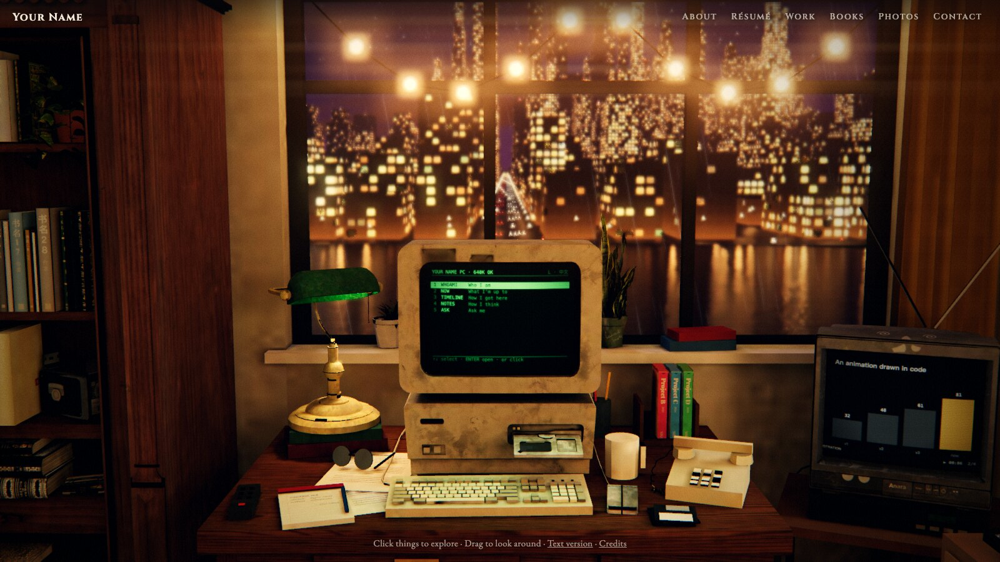
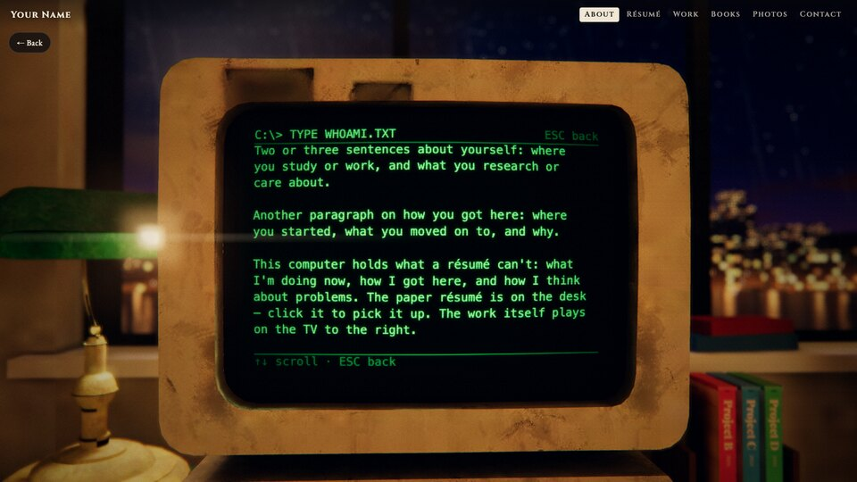
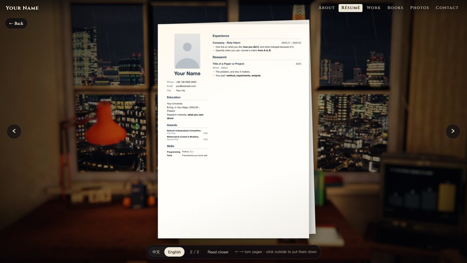
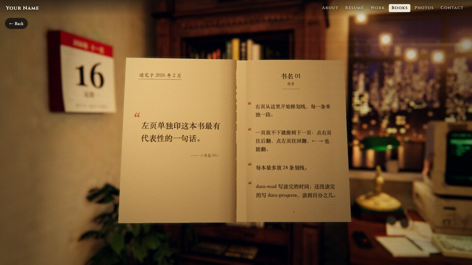

<h1 align="center">SceneCV · Step into your résumé</h1>

<p align="center">
  A 3D résumé template you can walk into.<br>
  The old computer tells visitors about you, the printed pages on the desk are your résumé, the TV plays your work, the bookshelf holds what you have read and the notepad has your contact details. Look around, click things, and get to know someone.
</p>

<p align="center">
  <a href="https://annoyingc.github.io/scene-cv/">Live demo</a> ·
  <a href="#run-it-locally">Run it locally</a> ·
  <a href="#make-it-yours">Make it yours</a> ·
  <a href="#what-you-can-do">What you can do</a> ·
  <a href="#third-party-assets">Credits</a>
</p>



- **The objects are the menu.** Click the computer, the printed pages, a tape, the bookshelf, the cork board or the notepad, and the camera flies over and opens that section. The books on the shelf are real books: click one and it slides out, flies up to you and opens. The top navigation bar and the address bar follow along, so every view has a link you can share.
- **The view outside is alive.** A light rain keeps falling, stars and the Milky Way turn slowly through gaps in the clouds, office lights switch on and off, car lights crawl along the streets, and raindrops ripple the reflections on the river.
- **The lighting is baked.** Blender scripts build the room and bake its lighting into textures, so the browser only has to display it; the first visit downloads about 8.5 MB. Switching lamps on and off or changing tapes still changes the light in the room.
- **One page, two ways to see it.** The 3D room and the plain-text version read the same `index.html`; devices that cannot run the 3D room get the text version automatically.
- **A static site with no dependencies.** There is no build step and no npm dependency. Edit `index.html` and put it on GitHub Pages, Vercel or Netlify.

Inspired by the spatial personal site at felixrieseberg.com. The name, résumé, work, reading list, photos and contact details in this repository are all samples; replace them with your own.

## A look around

<table>
  <tr>
    <td width="50%"></td>
    <td width="50%"></td>
  </tr>
  <tr>
    <td><b>Computer · About</b><br>The camera flies to the screen, where a terminal shows a menu: who I am, what I'm up to, how I got here, how I think, and questions people ask. Pick an item and its text types itself out letter by letter.</td>
    <td><b>Printed pages · Résumé</b><br>Click the two sheets on the desk and they float up into a stack of A4 pages you can leaf through. Several languages can share one stack, and you can jump straight to another language.</td>
  </tr>
  <tr>
    <td></td>
    <td></td>
  </tr>
  <tr>
    <td><b>VCR · Work</b><br>Each tape is a short programme in chapters, with subtitles under the TV. Click a tape on the rack and it flies into the VCR; after a burst of static it starts playing and the TV's colours light up the room. When a programme ends, the next tape goes in.</td>
    <td><b>Bookshelf · Reading list</b><br>Turn left to the bookshelf. Click a book and it slides out, flies up to you and opens: the left page carries the book's signature line, the right pages carry your highlights.</td>
  </tr>
  <tr>
    <td></td>
    <td></td>
  </tr>
  <tr>
    <td><b>Cork board · Photos</b><br>Aged photos are pinned under the wall clock, overlapping, with their corners curling. Up close you can drag them around.</td>
    <td><b>Lights</b><br>The desk lamp and the room lights can be switched off, leaving only the screens and the city outside. The image has a cinematic grade: warm lights bleed an orange-red halo, small bright lights draw thin horizontal streaks, and the focus follows whatever the camera is looking at.</td>
  </tr>
</table>

### Interface language and fonts

The interface is in English: the navigation bar, the hints on objects, the panels, the record card, the tape sleeves, the photo wall, the résumé viewer's buttons, the loading screen, the footer and the credits. The sample books on the shelf are in Chinese. The computer menu and the résumé can hold several languages, and visitors switch between them on the screen or on the stack of pages.

Fonts live in `assets/fonts/` (Latin subsets, SIL OFL; the licence texts are in the same folder): Cinzel for the navigation and headings, EB Garamond for hints, panels and buttons, and Playfair Display for the big titles on the tape sleeves. Chinese text falls back to Songti or the system font. The site serves its own font files and makes no requests to Google.

## Run it locally

You need Node.js 22 or newer. There are no npm dependencies and nothing to install or build:

```bash
node scripts/serve.mjs
```

Then open http://localhost:5173. `?room=1` forces the 3D version and `?plain=1` forces the text version. Everything is static files, so the folder can go straight to GitHub Pages, Vercel or Netlify.

**Scope:** the repository contains the desk room, its front-end interactions, the Blender scripts that build it and a local static file server. There are no accounts, no database, no API for saving a résumé and no online editor. Three.js and the Draco decoder load from a CDN, so the first run needs a network connection.

Checks: `npm test` covers the local server's access rules and the credits list; `npm run audit:public` scans tracked files for local paths, common credential patterns, contact details and files that should not be published. You can also keep a `.private-terms` word list that stays out of Git, listing words that must not appear in public files (see `scripts/audit_public.py`). Automated scans do not replace reading new content and third-party assets yourself.

## What you can do

| Interaction | Details |
|---|---|
| Opening view | The camera faces the computer on the desk under the window and orbits around it. Drag left to see the bookcase (the orbit centre shifts 15 cm to the left and the camera pulls back a little so the whole bookcase fits, and returns when you turn back); drag right to see the record player on the sideboard and the cork board (the centre shifts right and forward, the camera pulls back and tilts down slightly so the record player fits, and returns the same way). Scroll or pinch to zoom. The TV starts playing your work as soon as the page opens and cycles through the tapes |
| Navigation bar | Your name on the left; About / Résumé / Work / Books / Photos / Contact on the right. Clicking an item does the same as clicking its object: the camera flies over, the panel opens and the address changes. Hovering an item highlights its object. The current item is shown inverted; click it again or click your name to return to the desk. At first only About / Work / Contact are readable: Résumé, Books and Photos are blurred placeholders that cannot be clicked (hovering says "Not yet discovered") until the visitor finds them in the room (see Achievements). The text version has no locks |
| Achievements | Steam-style: the first time a visitor finds something, an achievement card slides in at the bottom right (it moves aside when a panel is open there): picking up the printed pages (Paper Trail), walking to the bookshelf (Bookworm) and taking a closer look at the cork board (Pinned Memories). At the same moment the matching navigation item comes into focus and becomes clickable. Unlocks are remembered in the browser (localStorage), so returning visitors don't have to find them again |
| Hover | Objects brighten and a hint appears next to them; a tape lifts a little out of the rack |
| Computer | The camera flies to the screen, which shows a terminal menu (the `.pc-menu` inside `#about`). Each item is a page of text or a list you can open (a timeline, notes, Q&A), typed out letter by letter; a timeline entry can "Play on the TV" the matching tape. There is one menu per language, switched on the screen |
| Printed pages · Résumé | Click the two sheets on the desk and they float up into a stack of A4 pages you leaf through left and right (`#resume`). One stack can hold several languages; the buttons above it jump to a language, and a `data-pdf` attribute adds a download button. Pages whose text does not fit are scaled down slightly |
| TV / tape rack | Work. The tapes on the rack (a Sketchfab model) stand upright in sleeves that the page draws from `#work`: the name runs down the spine, the front looks like an old rental tape and the back carries the summary and a barcode (the name is the `<a>` text, the colour is `data-color`). Click any tape: the previous one flies back to its slot, the new one lifts out whole and flies into the VCR, and after the static it starts playing while the TV's colours light the room. A tape can be a short programme in chapters (title card, an animation drawn in code, number cards, images, before/after wipes, video, side-by-side comparisons, end card), with subtitles and chapter marks under the TV; ↑↓ or clicking the TV changes chapters, and when it ends the next tape goes in |
| Panel | In the Work view there are ◀◀ ■ ▶▶ controls (keys ← → and Space) and a link to the project |
| Notepad / telephone | The contact details are handwritten on the notepad (a decal on the baked paper that follows the desk lamp's light), and the panel has clickable links |
| Bookshelf | On the left wall (drag left to turn towards it). The camera flies over without opening a list: the shelf itself is the table of contents, so visitors click the book they want (hovering shows its title). Books slide out a little on hover; clicked, a book slides out, flies up and opens (the address becomes `#shelf/<title>`), again without a panel. Books with many highlights have several pages: click the right page to turn forward, the left page to turn back, and anywhere else to put the book back; ← → turn pages and move to the next book at the end, Esc closes it |
| Cork board · Photos | Under the wall clock, with aged photos pinned to it. Click it and the camera moves up to the board, where the photos are viewed in place (`#photos`) and can be dragged around |
| Record player | Once you add tracks (see Make it yours), clicking the record player opens a record card: choose a record, play or pause, set the volume and switch between a vinyl sound and the clean recording; the record spins up to about 33⅓ RPM and slows to a stop when paused. Without tracks the turntable holds a blank record |
| Desk lamp, floor lamp, cabinet lamp | Click to switch them on and off; the lighting changes in real time |
| Credits | The "Credits" link in the footer (`#credits`): the author, original link, licence and changes for every third-party asset in the room. The camera stays where it is and only the panel opens |
| Routes | `#about` `#resume` `#work` `#shelf` `#photos` `#online` `#credits` are real addresses you can share; the browser's back button, the on-page "← Back", Esc and the name in the navigation bar all return to the desk |
| Loading | A download progress bar (about 8.5 MB); devices that cannot run WebGL2 go straight to the text version |
| Phones | In portrait the panel sits at the bottom and the camera tilts down to keep the object above it; resolution drops automatically and bloom and depth of field are switched off to keep the frame rate up |

## Make it yours

All content lives in `index.html`: the 3D version reads it, and the text version is that HTML itself. How to write each section is explained in comments inside `index.html`.

- Navigation: every `<section>` with a `data-nav` attribute gets an item in the top bar, labelled with the `data-nav` value. If you add a section that has no object in the room yet, its navigation item opens that section of the text version.
- Name and introduction: `<h1>`, `.tagline` and `#about`. The computer's menu is the `.pc-menu` inside `#about` (one per language).
- Résumé: each `article.cv-page` in `#resume` is one A4 page. If you'd rather not put your phone number and email in the public `index.html`, write the pages in `assets/resume/resume.html` instead (same markup; the folder is ignored by Git) and the page swaps them in at startup.
- Work: each `<li>` in `#work` is a tape; the rack on the desk holds 4. `data-tape` picks what the TV shows: `bars` / `synth` / `bounce` / `rain` are pictures drawn in code, and `show` is a programme in chapters whose `data-show` points to its programme file (`assets/tapes/<name>/show.json`; the chapter types are documented at the top of `js/tapes/show.js`, and there is a sample in `assets/tapes/sample/`). Animations used in programmes are written in `js/tapes/anims.js`. `data-color` sets the colour of the sleeve and of the TV's light.
- Reading list: each `<li>` in `#shelf` is one book: `<a>` holds the title and link, `.by` the author, `<blockquote class="key">` the line printed on its own on the left page, and the other `<blockquote>`s the highlights on the right pages. `data-size` (width × height × thickness in mm), `data-kind` (hardcover / paperback), `data-color` / `data-ink`, `data-style` (the style of the generated cover) and `data-read` / `data-progress` (when you finished it / how far you are) are explained in the comments. Changing the number of books or their sizes means re-baking the room, because the books are modelled from those sizes. Books fill the shelves in list order: first the shelf at eye level, then the one below, then the top one, and the remaining gaps are filled with old books. Real covers go in `assets/books/covers/` together with a `covers.json` (title → image file); that folder is ignored by Git, and `js/main.js` adds the covers by title at load time, falling back to generated covers.
- Photos: each `<li>` in `#photos` is an `` plus an optional caption. Age your photos first: put the originals in `photos-src/` and run `/Applications/Blender.app/Contents/MacOS/Blender -b --factory-startup --python blender/age_photos.py -- --src photos-src --out assets/photos`. This produces `<name>.webp`, `<name>.board.webp` (for the board, 1024 px on the long side) and a `photos.json` list; when that list exists the cork board uses those photos, otherwise it uses the ones in `#photos`. Ageing means yellowing, fading, blotchy stains and mould spots, worn corners and creases; the curling corners are real geometry in the page. Photo positions are remembered in the browser; run `__room.cmd('photos-reset')` in the console to put them back. Ageing re-encodes the images, so the originals' EXIF data (capture time, GPS location) is not carried over. `photos-src/` and `assets/photos/` are ignored by Git; the samples in this repository are a few blank aged photos (`assets/photos-sample/`, generated with `--demo 1`).
- Contact details: `#online`, shown both on the notepad and in the panel. You can also write them in `assets/resume/contact.html` (a few `<li>`s, ignored by Git); `js/main.js` swaps them into `#online` at load time.
- Wall poster and prints: the wall between the corner easel and the window has room for one large poster and five small prints below it (taped up like printouts in a lab; their sizes and places are `POSTERS` in `blender/bake_room.py`, keys `poster`, `poster_2` … `poster_6`). Age each image with `/Applications/Blender.app/Contents/MacOS/Blender -b --factory-startup --python blender/age_poster.py -- --src <image> --out assets/posters --name <name> --key <key> --title "<hover text>"`: a magazine cover gets faded ink, yellowed paper, a sun-bleached side, fold lines, worn edges and faint water stains; for a paper figure add `--sheet 1.414 --margin 0.06 --folds 0 --age 0.45` to lay it on a lightly aged sheet of white paper. Each run adds its entry to `assets/posters/posters.json`; the folder is ignored by Git, since covers and figures are usually someone else's work. Every piece has white tape on its corners, is baked into the room lighting together with the wall and casts no shadow, so without them the wall looks exactly as before.
- Personal mode: the private files above (`assets/resume/`, `assets/books/covers/`, `assets/photos/photos.json`, `assets/posters/posters.json`) are only read when the page is opened with `?personal` (for example `http://localhost:5173/?personal`) or the `<html>` tag carries a `data-personal` attribute. Without it the page shows only the samples in `index.html`, exactly as the public copy does, even if those folders exist on your machine.
- Music: the repository ships without music. Put mp3 files in `assets/audio/` (ignored by Git) and add an entry per track in `js/music-tracks.js` (`id`, title, artist, mp3 path, and the colour and text of the record label; the file has an example), and the record player works: a track loops once it plays, the default volume is 25%, the chosen record and volume are remembered in the browser, and audio only loads when you press play. The vinyl sound softens the highs and adds a little hiss and sparse crackle in real time; the files themselves are untouched.
- A new kind of TV picture: write a module in `js/tapes/` with the interface `mount({ ctx, width, height, tape }) → { frame(t, dt) }` and register it in `js/tapes/index.js`.

## Code layout

| File | Purpose |
|---|---|
| `js/main.js` | Checks the device and loads the 3D version or the text version; builds the navigation bar; swaps in a local résumé, contact list and cover list when they exist |
| `js/nav.js` | The navigation bar: built from the `section[data-nav]` elements; in 3D it calls the scene's `go()` (the same entry point as clicking an object), in the text version it uses in-page anchors; items not found yet are locked (blurred, not clickable) |
| `js/achievements.js` | Achievements: the list, the Steam-style card in the corner, unlocking navigation items, remembering unlocks in localStorage |
| `js/content.js` | Reads the content out of the HTML (introduction, menu, work, books, photos, contacts) |
| `js/baked.js` | Loads the baked scene (with progress), the lightmap shader, hotspot highlighting, the notepad decal, and splits the tapes into objects that can move on their own |
| `js/room.js` | Interaction: the camera (orbiting the computer and flying to objects), picking, routing, panels, tape animations, TV subtitles, lights |
| `js/grade.js` | Rendering and the overall look: the scene pass (multisampled) with white balance and depth of field, horizontal light streaks, then colour grading, vignetting, sharpening / softening, noise / grain and the VHS effect, with several presets |
| `js/pc.js` | The computer terminal: menu, typewriter effect, language switching |
| `js/resume.js` | The printed résumé: pages float up from the desk into a stack, page turning, language switching, automatic text fitting |
| `js/sleeves.js` | The tape sleeves: drawn from `#work`; sleeve and tape are merged into one box, with the sleeve's open top and finger notches filled in |
| `js/tv.js` / `js/tapes/` | The TV and each tape's picture (drawn on a 2D canvas used as a texture); `show.js` plays programmes in chapters, `anims.js` holds the animations drawn in code |
| `js/books.js` | The real books on the shelf: covers (spine and cover drawn on canvas, or real covers), sliding out on hover, flying up to the viewer, and opening as a live-lit book (signature line and reading status on the left page, highlights from the right page on, overflowing onto later pages, with a page that bends as it turns) |
| `js/photos.js` | The photo wall: a cork layer over the board, aged photos pinned on it (pins, shadows, curled corners), draggable |
| `js/music.js` / `js/turntable.js` / `js/vinyl-audio.js` / `js/music-tracks.js` | The record card and playback, the spinning record on the turntable, the vinyl sound, the track list |
| `js/window-view.js` | The rainy night outside: two layers of city panorama (read from data maps: the odd window light switching, traffic, obstacle lights), a live sky (for Tokyo: low rain clouds lit warm-grey by the city; for the old procedural city: stars, the Milky Way turning around the pole, the moon, drifting clouds) and rain |
| `js/deskcal.js` | The perpetual calendar on the desk: its cubes, weekday roller and month bars turn to today's date; click it to scramble them |
| `js/sfx.js` | Sound: rain outside the window, a quiet soundtrack while the TV plays a project, and short effects for books, papers, photos, switches, tapes, the calendar and the computer menu. It starts after the first click (browsers do not allow sound before that); the "Sound on / off" link at the bottom is remembered. The files and their CC0 sources are listed in [`assets/sfx/README.md`](assets/sfx/README.md) |
| `js/paint.js` | The notepad page |
| `blender/` | Python scripts that render the night view, build the room and bake its lighting; `age_photos.py` / `age_poster.py` age photos and the wall poster |
| `blender/render_view.py` and helpers | The view outside: `plateau_prep.py` converts PLATEAU CityGML, `osm_city.py` builds the OpenStreetMap buildings, roads and Tokyo Tower, `street_detail.py` the utility poles, trees, gardens and shop fronts, `window_atlas.py` / `sign_atlas.py` make the facade-photo and shop-sign atlases, `postfx.py` adds bloom and AgX tone mapping |
| `assets/vendor/` | The list of third-party 3D assets (`credits.json`) and notes on their licences |
| `scripts/fetch_assets.mjs` | Downloads the original third-party files used in the room into `vendor-src/` (not in the repository) |
| `scripts/fetch_city.mjs` | Downloads the city data for the view outside (OpenStreetMap, PLATEAU, three night photos) into `vendor-src/` and builds the intermediate files |
| `scripts/credits_html.mjs` | Generates the credits list in `index.html` from `credits.json` |
| `scripts/serve.mjs` | Local static file server (binds to localhost, serves only allowed file types) |

## Third-party assets

The room uses 25 third-party assets: 19 from Sketchfab (CC BY 4.0, which requires attribution and a note of changes) and 6 from Poly Haven (CC0). The view outside is built from map data and a city model: OpenStreetMap (© OpenStreetMap contributors, ODbL), MLIT's PLATEAU 3D city model of Minato City (Government of Japan Standard Terms of Use 2.0, compatible with CC BY 4.0), three CC0 night photos from Wikimedia Commons, and shop signs lettered in Noto Sans CJK (SIL OFL, the copy bundled with Blender; the font itself is not redistributed). The attribution is on the site under `#credits`, including the text version. The list is generated into `index.html` from `credits.json` by `node scripts/credits_html.mjs`; run it again whenever the assets change (`npm test` checks that it is up to date). These assets keep their own licences and are not covered by the repository's code licence; see [`assets/vendor/README.md`](assets/vendor/README.md) (in Chinese). The original files are not in the repository; download them again when you need them:

```bash
node scripts/fetch_assets.mjs
node scripts/fetch_city.mjs      # the data for the view outside (about 1.5 GB, then a few minutes of processing)
```

No coordinate in the room is hard-coded in JavaScript: every object's hotspot boxes, and where the camera looks and how much it frames when you click it, are computed by the bake script and written to `assets/baked/manifest.json` (`hotspots`, `views`, `tapes`, `books`, `photos`). Move an object in Blender and export again.

## Baked lighting (Blender → browser)

Two steps, both Python scripts that run without opening the Blender UI:

```bash
/Applications/Blender.app/Contents/MacOS/Blender -b --factory-startup --python blender/render_view.py -- --width 3840 --samples 64
```

```bash
/Applications/Blender.app/Contents/MacOS/Blender -b --factory-startup --python blender/bake_room.py -- --size 2048 --samples 1024
```

When you have only changed things that don't affect the lighting, such as hotspots or camera views, add `--skip-bake 1` to skip baking and re-export the model and manifest in a few seconds:

```bash
/Applications/Blender.app/Contents/MacOS/Blender -b --factory-startup --python blender/bake_room.py -- --skip-bake 1
```

- **The view outside** (`blender/render_view.py` + `js/window-view.js`): a rainy night over the real neighbourhood around Tokyo Tower, seen from 70 m above Azabu-Jūban, 0.8 km from Tokyo Tower, which stands just right of the computer. The buildings come from MLIT's PLATEAU 3D city model of Minato City (17,000 buildings, most with real roof shapes, measured heights, uses and storey counts, on real terrain) and, beyond the ward, from OpenStreetMap; the roads follow OpenStreetMap's lane counts, bridges and layers, so the Shuto Expressway runs on viaducts with parapets and piers. Tokyo Tower itself is modelled by script to its real profile: lattice legs, the arches at its foot, two observation decks, the antenna mast and the red-and-white paint bands, floodlit orange. Up close (within about 280 m) windows are drawn per floor from each building's use and storey height: office floors lit or dark as a whole, flats lit per home in mixed warm and cool light, some curtains half drawn; further away the facades are swatches cut from CC0 night photos of this same area, so distant windows look photographed. Near the camera there are utility poles with wires and street lamps, street trees, small trees in the gardens of detached houses, and shop fronts — izakaya with rows of red lanterns and noren, cafés with awnings and plants, a convenience store — with protruding and rooftop signs lettered in Noto Sans CJK. Cycles renders it as two partial panoramas (equirectangular, ±80° horizontally and −40° to +55° vertically, so no camera angle reaches an edge) in high dynamic range; `postfx.py` adds layered bloom and AgX tone mapping, and the near layer is rendered at 1.5× resolution and sharpened so that near detail is crisper than the distance. One layer holds everything within 250 m and one the rest, both WebP with transparent backgrounds, mapped in the browser onto spheres of 10 m and 40 m radius centred on the window so that near and far shift against each other as the mouse moves. Each layer has a half-resolution data map (per category: a random value for each lit window, traffic lanes, obstacle lights), which the browser uses to switch the odd window light on and off and blink the obstacle lights. Car lights are drawn separately: `view.json` stores each lane's start and end, cars drive along them at realistic speeds on the sphere of their layer, and the data map tells whether that direction is a lane or hidden behind a building. The sky is drawn live in the browser: low rain clouds lit warm-grey from below by the city, the moon hidden behind them; outside the window there are also a few thousand instanced rain streaks. A flat image, `view_full.jpg`, is rendered only to light the room during baking. `--osm ""` brings back the earlier procedural riverside city with its starry sky.
- **The room** (`blender/bake_room.py`): a small 3.3 × 3.0 m study with warm-white, linen-textured wallpaper. Behind the desk a 2.2 m white grid window (a Sketchfab model, glazed with a faint pane of glass) is centred on the computer and runs from a stone sill just above the desk up to the cornice, so its top never shows. In front of it stands a 1.5 m walnut desk (a 5.5 cm top with a bevelled edge, three drawers on the right and a shallow one in the middle, all with brass pulls; the wood grain is a 1024² texture generated at bake time, three boards with cathedral grain). In the middle is a beige vintage desktop computer (square screen, thin bezel, the monitor sitting on a horizontal case with a floppy in the drive and a sticky note on the side), with a home-built keyboard in front and a mouse to the right. Around it: a desk lamp standing on two old books, a wooden perpetual calendar in front of the lamp (a Sketchfab model whose number cubes, weekday roller and month bars the page turns to today's date), a tape rack (four tapes standing in sleeves), a coffee mug, glasses, a remote, a notepad and a pen pot, and some clutter: two printed pages, a stack of floppies and a push-button telephone (it counts as "contact" too). To the right of the desk a small cart carries the TV and the VCR, angled towards the camera. On the left wall, set forward so that it does not face the desk, stands a 2.3 m carved wooden bookcase (a Sketchfab model with a drawer at the bottom and five shelves), holding rows of old hardcovers (also Sketchfab), the real books modelled from the reading list, an 8 mm film camera, a few cassettes and a small trailing pothos; a monstera stands at its far end and a pile of books waits on the floor in front of it. In the back-left corner, standing out from the walls, a studio easel (Sketchfab) holds a gilded frame (Poly Haven) with Claude Monet's *Impression, Sunrise* (1872, public domain); hovering it shows the title. Right of the window hangs a tied-back oatmeal linen curtain; on the right wall are a sideboard, the record player, a picture, a clock and a 90 cm cork board (the photo wall) below it. The opening camera stands in front of the computer and orbits around it, with the computer and the window in the middle of the frame and half the TV showing on the right; the field of view is 34°, and the camera cannot tilt up to the ceiling. Turning left, the camera also drifts towards the left end of the desk: it passes the bookcase and ends facing the painting in the corner; turning right brings in the record player.
- **Four light layers** are baked: ambient (moonlight, the city outside and the computer screen), room lights (the floor lamp, the cabinet lamp, a soft invisible light along the top of the window and another on the bookcase), the desk lamp and the TV. Switching lights and changing the TV's colour only change coefficients in the shader; nothing is recomputed.
- **Rendering and the overall look** (`js/grade.js`), in several passes. `CameraPass` replaces RenderPass: it renders the scene into a 4× multisampled HDR buffer, then applies white balance and depth of field in linear light (thin-lens model: the focal length follows from the field of view and a 24 mm film height, and the focus distance follows the object the camera looks at, pulling slowly when it changes; a single spiral gather that reads mipmaps where the blur is large, so lights turn into bokeh). The five levels of bloom (UnrealBloomPass) can be tinted separately; an orange-red outer level is film halation. `StreakPass` stretches small bright lights horizontally, like an anamorphic lens: the highlights are reduced to a quarter, blurred four times horizontally only and added back. `GradePass` runs after tone mapping and handles colour grading, vignetting / natural lens falloff (cos⁴), sharpening / softening, chromatic aberration, sensor noise / film grain, and scanlines for the VHS look. The default is `cinema` (ACES, warm bloom with an orange-red halo, horizontal streaks on small bright lights, slightly teal shadows and warm highlights, a light f/4 depth of field, fine grain); `?look=<name>` picks another (`none` as rendered / `real` realistic camera / `film` warm film / `cine` night film / `vhs` VHS tape / `polaroid` faded print / `lofi` late-night lo-fi), and `?looks` shows a row of buttons at the bottom left to switch live. All parameters are in `LOOKS`, and each look can also change the bloom and halo colours, the streaks, the tone mapping and the aperture.
- **Hotspots**: while building the model, `with hot('about'):` tags the faces that belong to the computer, and the export computes tight boxes from those tags (they can rotate around the vertical axis to follow the angled notepad). In the browser, the box that contains the first face hit by the ray is what was clicked; the highlight is also computed in the shader from that box, so no extra geometry is needed.
- **The real books on the shelf**: the bake script reads the reading list from `index.html` and models each book at its size (hardcover boards overhang the pages), lays out the cover UVs horizontally as [back | spine | front], and the page paints the cover onto it. The manifest's `books` stores each book's position and size, and `photos` stores the position and orientation of the cork board's surface.
- **Shared dimensions** are in `blender/shared.py` (window size, desk height, moon direction, parameters of the view outside).

Measured on an Apple M5 (10-core GPU): the Tokyo view (far layer 3840×2280, near layer 5760×3420, 64 samples) takes about 7 minutes including building the scene, the data maps and the flat image; baking the room at 2048², 1024 samples and four layers takes about a minute.

## Debugging

- The page exposes `window.__room`; navigation clicks also go through `__room.go(id)`. `__room.go('work')` switches views, `__room.tick(dt)` advances one frame by hand (browsers slow animations down in background tabs), and `__room.hoverAt(x, y)` / `clickAt(x, y)` simulate the mouse.
- Achievements: `window.__achievements`. `__achievements.reset()` clears the unlocks (the navigation bar locks again after a reload), and `__achievements.unlock('photos')` unlocks one directly.

## About this repository

The name, résumé, work, reading list, photos and contact details in this repository are samples. Real résumés and contact details, real book covers, personal photos, music and the original third-party downloads are kept out of the repository (see `.gitignore`) and can stay on your own machine. The Blender scripts stay editable, and local path metadata has been removed from images and models. What was checked before publishing is listed in the [publication checklist](docs/PUBLICATION.md), and GitHub Pages setup is described in [docs/PAGES.md](docs/PAGES.md) (both in Chinese).

The code is released under the [MIT licence](LICENSE). The third-party 3D assets keep their own licences (CC BY 4.0 / CC0 1.0, see Third-party assets above) and the fonts are under the SIL OFL; neither is covered by the MIT licence.

## Next steps

1. Rain: the rain streaks outside and the ripples on the water are there; raindrops on the glass and wet streets with reflections are still missing.
2. Sound effects: rain, light switches, inserting a tape, terminal typing.
3. Model compression (Meshopt) and AVIF / KTX2 textures to bring the 8.5 MB download down.
